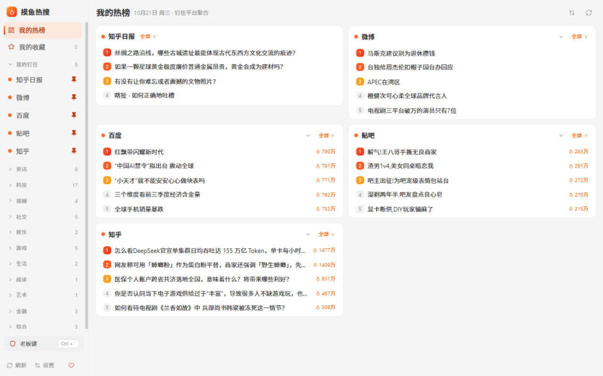
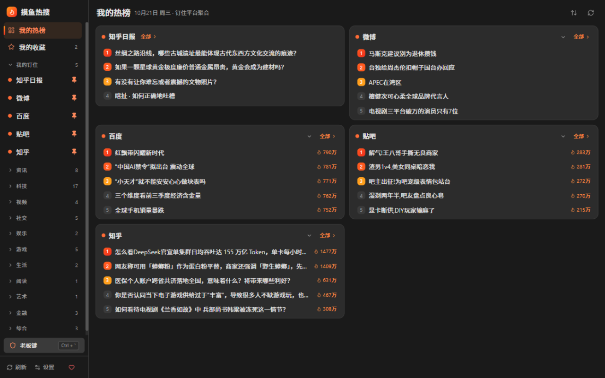
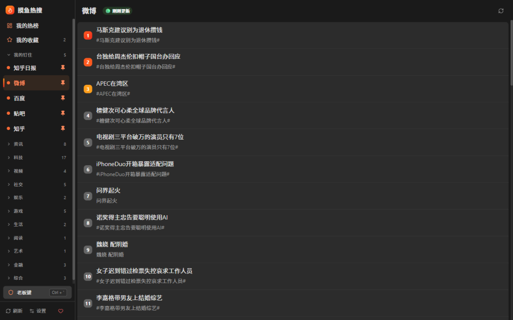
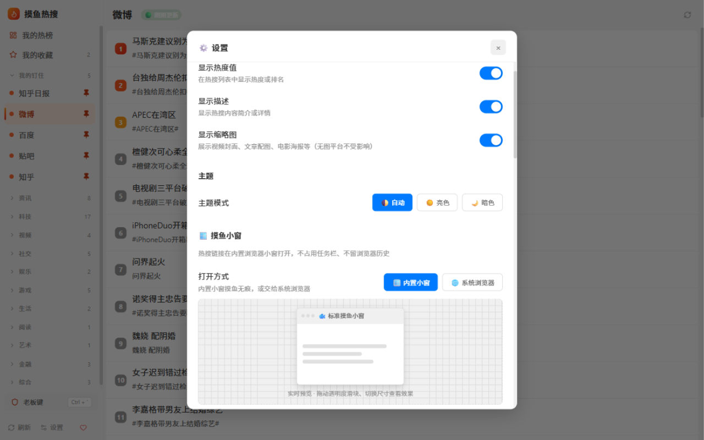

# 摸鱼热搜 - uTools 插件

<div align="center">


**52 平台热搜一站式聚合 + 内置浏览器小窗摸鱼 + 老板键一键隐身**

[更新日志](CHANGELOG.md) • [快速开始](#-快速开始) • [使用指南](#-使用指南) • [快捷键](#️-键盘快捷键) • [常见问题](#-常见问题)

</div>

---

## ✨ 功能特性

### 🏠 聚合首页（v2.0 全新布局）

- **左侧平台栏 + 聚合首页** - 常用平台「钉住」置顶（聚合首页最多展示 8 张卡片），一屏看遍多个平台的热搜
- **聚合卡片** - 常显 5 条，悬停后滚轮直接翻看；点「展开」查看完整榜单（50 条）；Top3 渐变徽章、热度值、加载骨架屏，单卡失败不拖垮整页
- **拖拽排序** - 聚合首页拖拽调整钉住平台顺序，插入式指示线
- **暗色主题** - 自动跟随系统 / 亮色 / 暗色三种模式，全面适配

### 🐟 摸鱼小窗

- **内置浏览器小窗** - 热搜链接在 uTools 内置浏览器中打开：**不占任务栏、不留浏览器历史**
- **窗口可调** - 打开方式（内置小窗 / 系统浏览器）、三档尺寸、透明度、置顶均可调，设置页实时预览
- **记住位置** - 记住上次窗口位置和手动调整的大小
- **自动静音** - 小窗打开后视频/音频自动静音，防止摸鱼出声；右下角气泡一键恢复声音
- **站点净化** - 知乎、微信公众号、GitHub、掘金、豆瓣等 10 个站点自动隐藏侧栏推荐、加宽正文，沉浸阅读

### 🛡️ 老板键

- **`Ctrl + \``** - 任何界面（含设置弹窗、输入框聚焦时）一键隐藏**所有摸鱼小窗 + 主窗口**，再按一次原样恢复
- **全局快捷键** - 在 uTools 中为「老板键」功能绑定全局快捷键（如 `Alt+Q`），任何应用下按一下，一切归零
- **鼠标入口** - 侧栏底部 Shield 按钮，鼠标党同样可用

### 📋 其他能力

- **我的收藏** - 跨平台收藏流，随时回看
- **AI 智能翻译** - 芝加哥艺术学院、GitHub 热榜、Hacker News 标题/描述一键翻译（utools AI），结果本地缓存
- **内容增强** - 视频封面 / 文章配图缩略图、作者信息、描述清洗（去 HTML 标签 / 乱码）
- **完整键盘流** - 详见下方[快捷键](#️-键盘快捷键)，双手不离键盘刷热搜
- **智能数据源** - 三级回退：插件内置 DailyHotApi 本地服务 → uapis.cn → api-hot.imsyy.com 公共实例，单源故障自动降级

---

## 🏗️ 支持的平台（52 个 · 11 分类）

| 分类 | 平台 |
|------|------|
| 📊 综合 | 百度、简书、历史上的今天 |
| 💬 社交 | 微博、知乎、知乎日报、贴吧、水木社区 |
| 🎬 视频 | B站、抖音、快手、AcFun |
| 📰 资讯 | 今日头条、澎湃新闻、腾讯新闻、新浪热搜、新浪新闻、网易新闻、虎嗅、爱范儿 |
| 💻 科技 | 36氪、IT之家、IT之家·喜加一、CSDN、掘金、V2EX、少数派、酷安、果壳、51CTO、NodeSeek、极客公园、吾爱破解、HelloGitHub、GitHub热榜、Hacker News、Product Hunt |
| 🎮 游戏 | 米游社、原神、崩坏3、星穹铁道、英雄联盟、Epic免费游戏 |
| 🎬 娱乐 | 豆瓣电影、豆瓣小组 |
| 🏃 生活 | 虎扑、什么值得买 |
| 📚 阅读 | 微信读书 |
| 💰 金融 | 热门股票、上证指数、科技股 |
| 🎨 艺术 | 芝加哥艺术学院 |

> 📌 持续更新中，欢迎建议更多平台！

---

## ⌨️ 键盘快捷键

| 按键 | 功能 |
|------|------|
| `←` / `→` | 上一个 / 下一个平台（循环） |
| `↑` / `↓` | 选中上一条 / 下一条热搜 |
| `PageUp` / `PageDown` | 翻页滚动 |
| `1` - `9` | 跳到第 N 条并选中（不与 Ctrl/Alt/Meta 组合冲突） |
| `c` | 复制选中标题（仅无修饰键时触发，`Ctrl+C` 复制自选文本不受影响） |
| `f` | 收藏 / 取消收藏选中条目（仅无修饰键时触发） |
| `Enter` | 内置浏览器小窗打开选中条目 |
| `F5` / `Ctrl+R` | 刷新当前平台 |
| `Ctrl+T` | 翻译当前平台（仅芝加哥艺术学院、GitHub热榜、Hacker News） |
| `` Ctrl+` `` | **老板键**：隐藏 / 恢复所有摸鱼窗口（任何界面可用） |
| `Esc` | 分层退出：先关弹层，再退出插件 |

> 💡 输入框聚焦、中文输入法候选期内快捷键不会触发

---

## 🚀 快速开始

### 📦 安装方式

#### 方式一：uTools 插件市场（推荐）

1. 打开 [uTools](https://www.u-tools.cn/)
2. 在插件市场搜索 **"摸鱼热搜"** 或 **"热搜"**
3. 点击安装即可使用

#### 方式二：本地开发

```bash
# 1. 克隆项目
git clone https://github.com/575568329/MYRS.git
cd MYRS

# 2. 安装依赖
npm install

# 3. 启动开发服务器（默认 http://localhost:5173）
npm run dev

# 4. 构建生产版本
npm run build

# 5. 在 uTools 中安装本地插件
# uTools -> 设置 -> 开发者模式 -> 安装本地插件 -> 选择项目目录
```

### 🎯 唤醒插件

在 uTools 中输入以下关键词即可唤醒：

- **热搜** / **热榜** / **热点** / **今日热点** / **摸鱼**
- **老板键** - 单独入口，可在 uTools 中为其绑定全局快捷键

---

## 📖 使用指南

### 基础操作

1. **切换平台** - 点击左侧平台栏的分类与平台；常用平台可「钉住」置顶；也可以用 `←` / `→` 键循环切换
2. **聚合首页** - 默认进入，钉住的平台各显示一张卡片，悬停滚轮翻看，点「展开」看完整榜单
3. **打开热搜** - 点击条目（或选中后按 `Enter`）在内置小窗打开，不占任务栏、不留历史
4. **收藏** - 条目悬停收藏按钮或按 `f`，左侧「我的收藏」随时回看
5. **刷新** - 侧栏底部刷新按钮或 `F5` / `Ctrl+R`

### ⚙️ 设置说明

点击侧栏底部「设置」按钮打开设置面板：

- **显示选项** - 热度值 / 简介 / 缩略图开关
- **主题** - 自动 / 亮色 / 暗色
- **摸鱼小窗** - 打开方式、尺寸（三档）、透明度、置顶、自动静音、记住位置大小、站点净化，实时预览
- **平台显示** - 钉住顺序、隐藏不需要的平台
- **键盘快捷键** - 完整快捷键说明

更详细的使用说明见 [USER_GUIDE.md](USER_GUIDE.md)。

---

## 🛠️ 技术栈

| 技术 | 说明 | 版本 |
|------|------|------|
| **Vue 3** | 渐进式 JavaScript 框架 | ^3.5.13 |
| **Pinia** | 状态管理 | ^3.0.4 |
| **Vite** | 下一代前端构建工具 | ^6.0.11 |
| **uTools API** | uTools 插件开发接口（ubrowser / AI / 全局快捷键） | - |
| **Remix Icon** | 开源图标库（vue-remix-icons，按需加载） | ^3.16.0 |
| **DailyHotApi** | 热搜数据源（插件内置本地实例） | [GitHub](https://github.com/imsyy/DailyHotApi) |

### 📦 项目结构

```
MYRS/
├── src/
│   ├── HotSearch/              # 热搜主视图（列表 / 聚合首页 / 键盘流）
│   ├── Settings/               # 设置面板
│   ├── components/
│   │   ├── AggregateHome.vue   # 聚合首页（卡片 / 拖拽排序）
│   │   ├── PlatformSidebar.vue # 左侧平台栏（分类 / 钉住 / 老板键）
│   │   ├── FavoritesView.vue   # 我的收藏
│   │   ├── ArtworkCard.vue     # 艺术品卡片（芝加哥艺术学院）
│   │   └── ...
│   ├── services/
│   │   ├── hotSearchApi.js     # API 封装（三级回退数据源）
│   │   ├── analytics/          # 埋点（Pantry 上报）
│   │   └── platforms/          # 自定义平台抓取（艺术 / Epic 等）
│   ├── stores/                 # Pinia（settingsStore / hotSearchStore）
│   ├── utils/
│   │   ├── bossKey.js          # 老板键（隐藏 / 恢复所有摸鱼窗口）
│   │   ├── openUrl.js          # 小窗打开三级降级
│   │   ├── siteRules.js        # 站点净化规则（10 站）
│   │   └── ...
│   ├── config.js               # 应用配置
│   └── main.js                 # 入口
├── public/
│   ├── preload/                # uTools preload（含内置 DailyHotApi 本地服务）
│   └── plugin.json             # uTools 插件配置
└── docs/                       # 设计文档（UX 重构 / 摸鱼小窗 2.0 / 实现记录）
```

---

## 🔧 配置说明

`src/config.js` 主要配置项：

```javascript
// 显示模式
DISPLAY_MODE = {
  DEFAULT_MODE: 'simple',       // 默认进入聚合首页
}

// UI 配置
UI = {
  SHOW_HOT_VALUE: true,         // 是否显示热度值
  SHOW_DESCRIPTION: true,       // 是否显示简介
  SHOW_THUMBNAILS: true,        // 是否显示缩略图
  THEME_MODE: 'auto'            // 'auto' 自动 | 'light' 亮色 | 'dark' 暗色
}

// 分页配置
PAGINATION = {
  DEFAULT_PAGE_SIZE: 50,        // 每页显示条数
  LOAD_MORE_THRESHOLD: 100      // 距离底部多少像素触发加载更多
}

// API 配置
API = {
  LOCAL_API_BASE: 'http://localhost:6688',  // 内置 DailyHotApi 本地服务
  REQUEST_TIMEOUT: 5000,                    // 默认请求超时（毫秒）
  PLATFORM_TIMEOUT: { /* 平台专属超时 */ },
  PLATFORM_CACHE_TIME: { /* 平台专属缓存时长 */ },
  HIGH_FREQUENCY_PLATFORMS: [...],          // 高频平台（缓存更短）
  DEBUG: import.meta.env.DEV                // 调试日志跟随构建环境
}

// 摸鱼小窗默认值
FISH_WINDOW_DEFAULTS = { /* 打开方式 / 尺寸 / 透明度 / 置顶 / 静音等 */ }
FISH_WINDOW_SIZES = { /* 三档尺寸 */ }
```

---

## 🐛 常见问题

### Q1: 为什么有些平台加载失败？

**A**: 数据源为三级回退（内置本地服务 → uapis.cn → api-hot.imsyy.com），全部失败才会提示错误。可以点击刷新重试，或稍后再试。

### Q2: 老板键怎么绑定全局快捷键？

**A**: uTools 设置 → 快捷键 → 为「摸鱼热搜 - 老板键」功能设置全局快捷键（推荐 `Alt+Q`）。绑定后任何应用下按一下即可隐藏所有摸鱼窗口，再按一次恢复。插件内也可直接用 `Ctrl+ \``。

### Q3: 翻译功能如何使用？

**A**: 切换到芝加哥艺术学院 / GitHub热榜 / Hacker News，点侧栏底部「翻译」按钮（或 `Ctrl+T`），批量翻译每批最多 200 条，结果自动缓存到本地，下次打开自动加载。需要 uTools 已配置 AI 模型。

### Q4: 数据多久更新一次？

**A**: 各平台独立缓存配置（高频平台如微博/知乎/百度缓存更短），随时可手动刷新。

### Q5: 如何开发调试？

**A**: `npm run dev` 启动后，在 uTools 开发者模式下以 `http://localhost:5173` 调试（plugin.json 已配置 development.main）。生产构建自动移除调试日志。

更多问题见 [USER_GUIDE.md](USER_GUIDE.md) 的故障排除章节。

---

## 📸 功能预览

| 聚合首页（亮色） | 聚合首页（暗色） |
|:---:|:---:|
|  |  |

| 平台列表 | 摸鱼小窗 |
|:---:|:---:|
|  |  |

---

## 📝 更新日志

见 [CHANGELOG.md](CHANGELOG.md)。

---

## 🤝 贡献指南

欢迎提交 Issue 和 Pull Request！

1. Fork 本项目
2. 创建特性分支 (`git checkout -b feature/AmazingFeature`)
3. 提交更改 (`git commit -m 'Add some AmazingFeature'`)
4. 推送到分支 (`git push origin feature/AmazingFeature`)
5. 开启 Pull Request

---

## 📄 开源协议

本项目采用 **MIT License** 开源协议。

---

## 🙏 致谢

- [DailyHotApi](https://github.com/imsyy/DailyHotApi) - 热搜数据 API
- [uTools](https://www.u-tools.cn/) - 优秀的效率工具平台
- [Vue.js](https://vuejs.org/) / [Vite](https://vitejs.dev/) / [Remix Icon](https://remixicon.com/)

---

<div align="center">

**[⬆ 回到顶部](#摸鱼热搜---utools-插件)**

Made with ❤️

</div>
