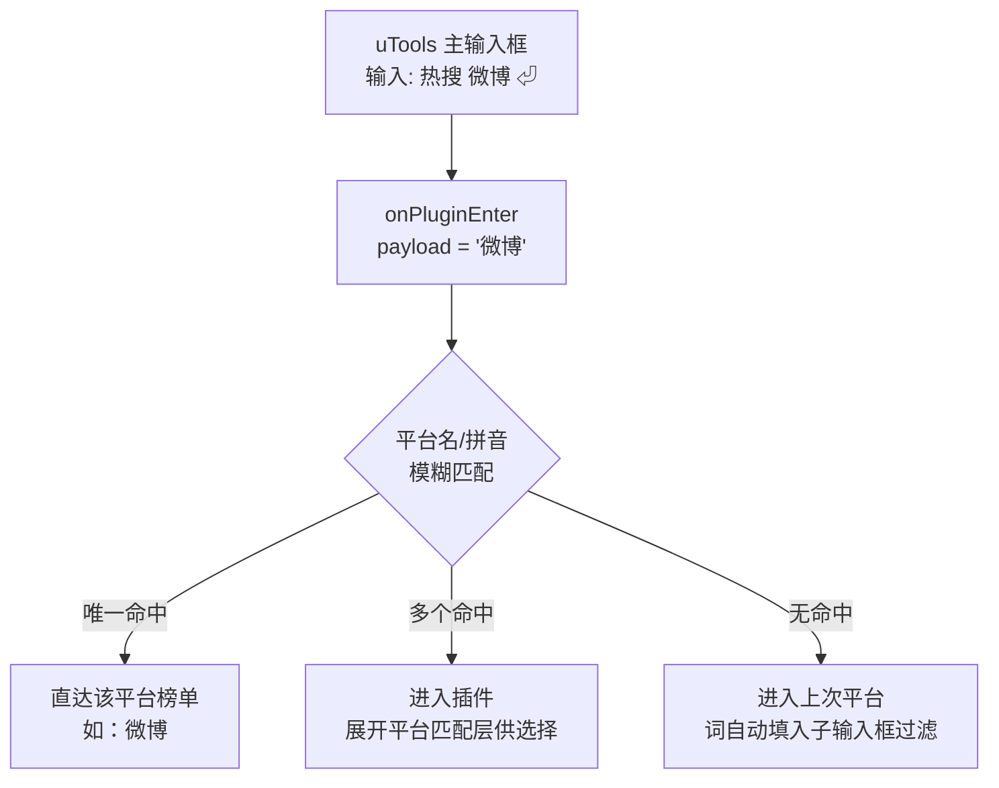
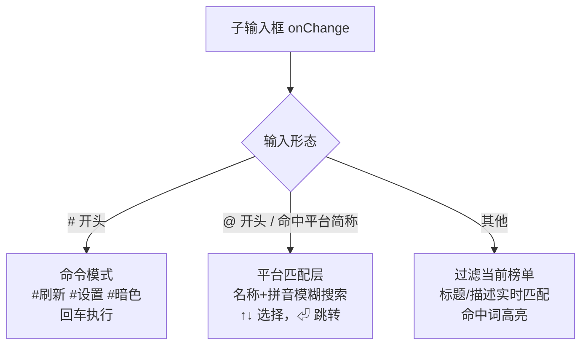
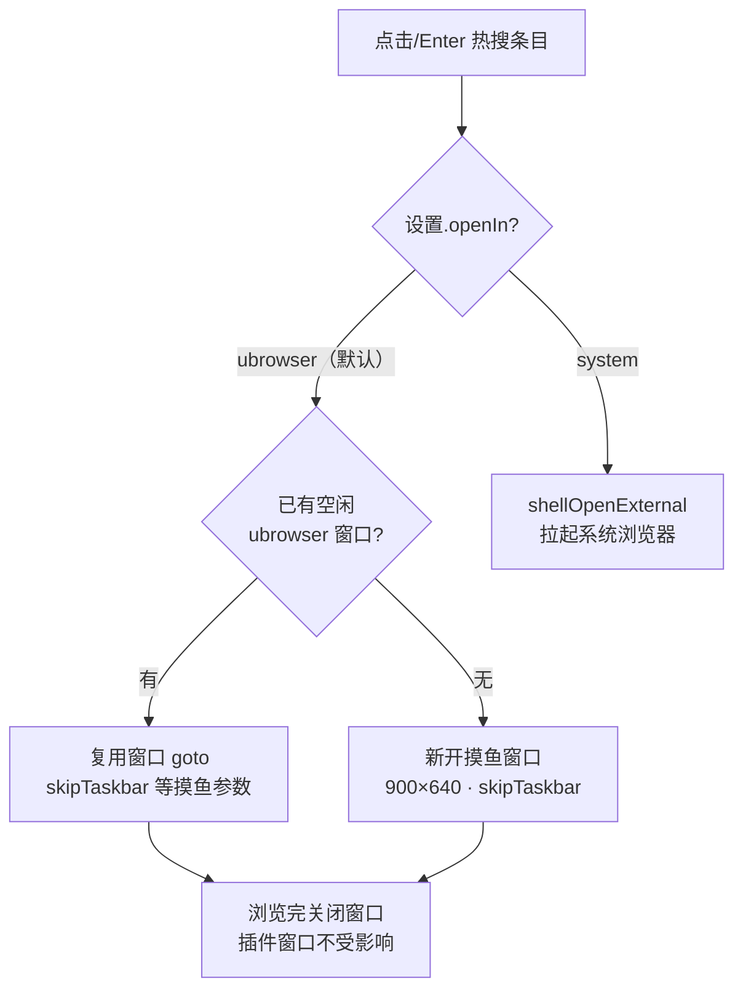
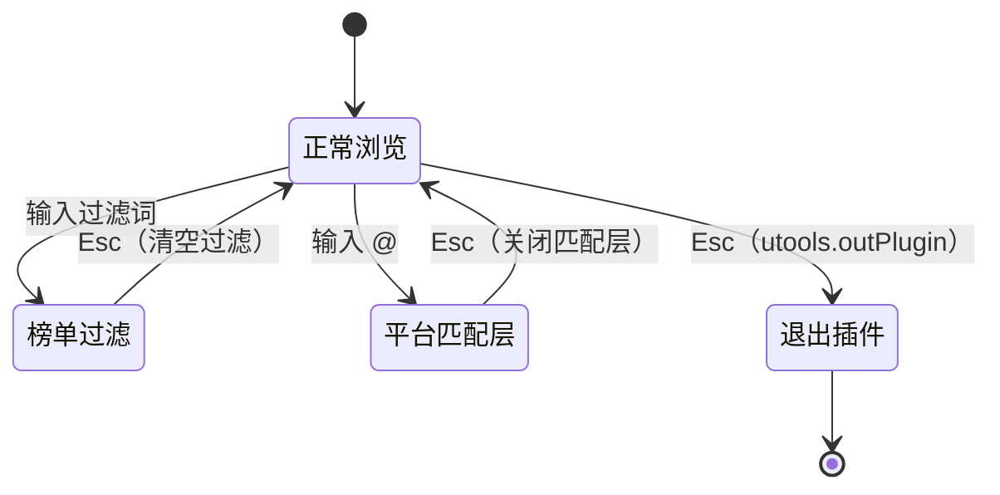
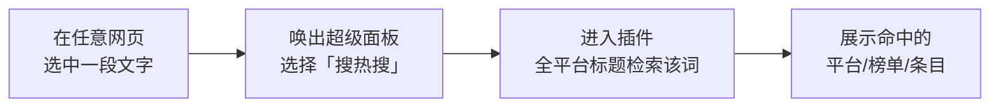

# 摸鱼热搜 uTools 交互重设计研究

> 分支：`feat/ux-redesign` ｜ 状态：研究提案（未实施） ｜ 日期：2026-10-20
>
> 图示说明：界面线框图使用 ASCII（等宽查看），交互流程使用 Mermaid（GitHub / VS Code 可直接渲染）。

## 1. 研究目标

摸鱼场景的核心诉求是**快进快出**：用户在工位上只有几秒到几十秒的窗口，想"瞄一眼今天有什么热的，有兴趣的点开看，没兴趣立刻关"。当前的界面是"网页式"设计——靠鼠标滚动、逐个点选——没有利用 uTools 作为效率启动器的平台特性。本研究回答：**界面和操作方式应该怎么重新设计，才能让用户用起来最顺手？**

## 2. 现状盘点（问题清单）

基于代码走读（`src/HotSearch/index.vue` 2735 行、`src/Settings/index.vue`、stores、`public/plugin.json`）：

| # | 问题 | 证据 | 影响 |
|---|---|---|---|
| P1 | **42/58 个平台 UI 不可达** | `config.js:19` 硬编码 `DEFAULT_MODE: 'simple'`，分类导航仅在 category 模式渲染（index.vue:1256）；新接入的 DailyHotApi 平台全部不可见 | 内嵌的 56 路由服务大部分被浪费 |
| P2 | **无全局搜索/子输入框** | 全项目无 `setSubInput` 调用；平台只能横向滚动 pill 条或 ←→ 逐个切换 | 跳到远处平台成本极高 |
| P3 | **收藏是死功能** | `hotSearchStore.toggleFavorite/isFavorite`（store:338-397）已实现并持久化，但主界面零入口，`favoriteItems` 声明后从未使用 | 功能感知为零 |
| P4 | **最近使用无展示** | `addToRecentPlatforms` 持久化正常，UI 无消费（`UI.SHOW_RECENT_PLATFORMS` 配置项无人读） | 白白记录 |
| P5 | **入口关键词未利用** | `onPluginEnter`（App.vue:22-29）只强改 code，`payload/type` 全丢弃 | "热搜 微博"直达不可能 |
| P6 | **条目操作单一** | 整行 click → `shellOpenExternal`（index.vue:1406），无复制、无收藏、无后台打开 | 想只复制标题做不到 |
| P7 | **键盘流不完整** | 有 ↑↓←→/Enter/F5/Ctrl+T（index.vue:889-975），但无 Esc、数字跳转、收藏/复制快捷键；键盘选中与鼠标 hover 不联动 | 键鼠割裂 |
| P8 | **翻译用原生 confirm/alert** | index.vue:772/798/567 | 风格割裂、打断心流 |
| P9 | **设置入口深、信息架构乱** | 右下角悬浮齿轮；设置页大段 API 说明/免责声明把高频的排序/隐藏压到很深（Settings:249-330） | 高频操作路径长 |
| P10 | **状态双轨漂移** | `hotSearchStore.js`（551 行）与 index.vue 本地状态重复实现（如可翻译平台清单两边不一致） | 维护隐患 |
| P11 | 排序/隐藏列表只覆盖极简 20 平台 | settingsStore:57-59 初始化 | 与 P1 连锁 |

## 3. uTools 平台能力清单（我们还没用上的）

| 能力 | API | 可解决 |
|---|---|---|
| **子输入框** | `utools.setSubInput(onChange, placeholder, isFocus)`——进入插件后主输入框变成插件可用的输入框 | P2：成为全局搜索中枢 |
| **进入意图** | `onPluginEnter({code, type, payload})`，type 含 `text`/`regex`/`over`（超级面板），`from` 区分主输入框/面板 | P5：关键词直达 |
| **剪贴板/通知** | `utools.copyText()`、`utools.showNotification()` | P6：一键复制；新玩法：预警推送 |
| **退出控制** | `utools.outPlugin()`、`utools.hideMainWindow()` | Esc 快退 |
| **超级面板** | plugin.json feature `type: "over"`，选中文字唤起 | "选中词条→搜它上没上热搜" |
| **正则特征** | plugin.json cmds 支持对象形式 `{"type":"regex"}` | 智能入口 |
| 已用未深挖 | `dbStorage`、`shellOpenExternal`、`utools.ai` | — |

## 4. 设计原则

1. **键盘优先，鼠标等价**：核心路径（进平台→看→打开/复制）全程可键盘完成，鼠标永远有等价操作。
2. **一个搜索框解决所有跳转**：不做多级导航，过滤榜单、跳平台、执行命令都收敛到子输入框。
3. **所有平台零成本可达**：58 个平台不能因为默认视图设置而不可见。
4. **打断最小化**：去掉所有 confirm/alert，用内联确认和 toast。
5. **快进快出**：任何状态 ≤2 次 Esc 回到"刚进入"状态，再 Esc 退出插件。

## 5. 重设计方案

### 5.1 入口层：关键词直达（解 P5）

- plugin.json 增加一个 `text` 类型 feature（如 `热搜 {query}`），用户在 uTools 主输入框输 `热搜 微博` 回车 → `onPluginEnter` 拿到 `payload="微博"` → 模糊匹配平台名/拼音 → 直达微博榜单；匹配不到则进入当前平台并把词填入子输入框过滤。
- 现有 5 个关键词（热搜/热榜/摸鱼/热点/今日热点）保持不动，零学习成本。



### 5.2 子输入框 = 全局命令中枢（解 P2，本项目最大单点提升）

进入插件即 `setSubInput`，placeholder：`"过滤榜单 · @跳平台 · #命令"`。输入实时解析三种意图：

| 输入形态 | 行为 |
|---|---|
| 普通文字（默认） | 实时过滤**当前榜单**标题/描述，高亮命中词 |
| `@xxx` 或平台拼音/简称（wb、zh、bz…） | 弹出平台匹配列表（名称+拼音模糊匹配 58 平台），↑↓选择回车跳转；直接回车选第一个 |
| `#刷新` `#设置` `#暗色` 等 | 命令模式，少量高频命令 |

退出过滤：清空或 Esc。**这一个机制同时替代了"分类导航 + 横向滚动条 + ←→切换"三种笨重方式**，也天然解决 P1（全部平台通过 @ 可达，分类导航可保留为鼠标用户的补充）。

**主界面改造前后对比：**

```text
【现状】                                【方案】
┌──────────────────────────────┐      ┌──────────────────────────────┐
│ [微博🟢][知乎][百度][B站][抖音] →│      │ 🔍 过滤榜单 · @跳平台 · #命令  │ ← 子输入框
├──────────────────────────────┤      ├──────────────────────────────┤
│                              │      │ [★5][最近][微博🟢][知乎][+全部]│ ← 分组胶囊
│ 1  未来廉价航空…       🔥4.8M │      ├──────────────────────────────┤
│                              │      │ ☆1 未来廉价航空… [📋][🔗][↗]🔥 │ ← hover操作
│ 2  LPL四队…            🔥3.2M │      │ ★2 LPL四队…    [📋][🔗][↗]🔥 │
│                              │      │ ☆3 …                         │
│ 3  …                         │      │                              │
│                              │      │                              │
│                 [❤️][🔄][⚙️]  │      │                 [❤️][🔄][⚙️]  │
└──────────────────────────────┘      └──────────────────────────────┘
  ↑ 20个平台横向滚动，                  ↑ 子输入框统一入口 + 分组胶囊
    条目只能整行点击打开                  + 行内操作，58平台全可达
```

**子输入框三态解析逻辑：**



**`@` 平台匹配层展开效果：**

```text
┌──────────────────────────────┐
│ 🔍 @wb_                       │
├──────────────────────────────┤
│ ▸ 微博      wb / weibo        │ ← 实时匹配，回车直达
│   网易新闻   wy / wangyi      │
│   什么值得买 smzdm / sm        │
│                              │
│  ↑↓ 选择 · ⏎ 跳转 · Esc 关闭  │
└──────────────────────────────┘
```

### 5.3 平台选择器重设计（解 P1/P11）

- 顶部平台条改为**分组胶囊**：`★收藏`（见 5.4）｜`最近`（最近 5 个）｜`常用`（现极简列表）｜`全部`（弹出式网格，按分类分组+搜索框，鼠标路径）。
- **导航栏内容由用户定义**：收藏哪个平台，它就固定出现在导航栏最前面的 ★ 组——"我看到什么"由"我收藏什么"决定，而不是代码里的硬编码列表。未收藏的平台通过 `@` 搜索或"全部"网格可达，用过即入"最近"。
- `DEFAULT_MODE` 保持 simple 不破坏老用户习惯，但"全部"入口让 58 平台可达；设置里的排序/隐藏列表同步扩到全平台。
- 新平台（极客公园等 4 个）默认进"全部"组，用户用过即入"最近"。

**平台条分组胶囊 + "全部"弹出网格：**

```text
 顶部平台条（常态）
┌──────────────────────────────────────────┐
│ [★ 5] [最近 ▾] [微博 🟢] [知乎] [百度] [ ⋯ 58 全部] │
└──────────────────────────────────────────┘
                        │ 点击"全部"
                        ▼
┌──────────────────────────────────────────┐
│ 🔍 搜索平台（拼音/简称）_                    │
├──────────────────────────────────────────┤
│ 视频      [B站] [抖音] [快手] [AcFun]      │
│ 资讯      [微博] [百度] [头条] [澎湃] …     │
│ 科技      [掘金] [IT之家] [少数派] …       │
│ 生活      [虎扑] [什么值得买] …            │
│ 综合      [历史上的今天] [水木社区] …       │
│ 艺术/阅读 [大都会] [芝加哥] [微信读书] …   │
└──────────────────────────────────────────┘
```

### 5.4 收藏与最近使用激活（解 P3/P4）

- 列表项 hover 左侧出现空心星标，点击收藏（星标实心）；键盘 `f` 收藏当前选中条。
- 顶部平台条第一组即"★收藏（条目）"：点开是跨平台收藏流——这是"摸鱼日报"的雏形，高价值。
- 收藏条目存 `dbStorage`，含平台、标题、链接、收藏时间。

**★收藏流视图（点顶部 [★ 5] 进入）：**

```text
┌──────────────────────────────────────────┐
│ ★ 我的收藏（5）              [全部清理]    │
├──────────────────────────────────────────┤
│ 微博    │ 未来的廉价航空        2 小时前    │
│ 知乎    │ 21岁男子稻城亚丁…     昨天        │
│ 36氪    │ 优衣库的答案不再是中国 昨天        │
│ IT之家  │ iPhone 17 Pro Max…   3 天前      │
│ GitHub  │ ai-job-search        上周        │
└──────────────────────────────────────────┘
  ↑ 跨平台聚合，每行点开直达原文，可按平台/时间筛选
```

### 5.5 条目操作矩阵（解 P6）

| 操作 | 鼠标 | 键盘 |
|---|---|---|
| 打开 | 整行 click | Enter |
| 复制标题 | hover 行内 📋 | c |
| 复制链接 | hover 行内 🔗 | C（shift+c） |
| 收藏 | hover 星标 | f |
| 后台打开（不抢焦点） | hover 行内 ↗ | b |

复制用 `utools.copyText()` + toast「已复制」，替代任何弹窗。

#### 5.5.1 内置浏览：用 ubrowser 打开，不拉系统浏览器（新增需求）

**现状问题**：整行点击 → `shellOpenExternal` 拉起 Chrome/Edge——摸鱼场景致命：任务栏弹出浏览器图标、窗口切换动静大。

**方案**：默认改用 uTools 内置浏览器 **ubrowser**（`utools.ubrowser.goto(url).run(options)`），在 uTools 体系内的独立浏览器窗口中打开。为什么不内嵌 iframe/webview：微博/知乎/B站等站点均设置 `X-Frame-Options`/CSP 拒绝被框架嵌入，iframe 白屏；webview 标签需宿主开启，插件无法控制。ubrowser 是官方解法。

```js
// 统一打开入口（index.vue 现有 openUrl 改造）
const openUrl = (url, { background = false } = {}) => {
  if (settings.openIn === 'system' || !window.utools) {
    return window.utools
      ? utools.shellOpenExternal(url)          // 用户明确选择系统浏览器
      : window.open(url, '_blank');            // 浏览器开发环境降级
  }
  // 摸鱼模式窗口：不在任务栏显示 + 可置顶 + 半透明（Windows）
  return utools.ubrowser.goto(url).run({
    show: !background,
    width: settings.fishWindow.width,          // 默认 900
    height: settings.fishWindow.height,        // 默认 640
    skipTaskbar: settings.fishWindow.skipTaskbar,   // 默认 true ★摸鱼核心
    alwaysOnTop: settings.fishWindow.alwaysOnTop,   // 默认 false
    opacity: settings.fishWindow.opacity,           // 默认 1，可调 0.6~1
  });
};
```

**ubrowser 摸鱼特性**（来自官方 API，均可用 `run(options)` 配置）：

| 特性 | 参数 | 摸鱼价值 |
|---|---|---|
| 不进任务栏 | `skipTaskbar: true` | 任务栏无痕迹，Alt+Tab 不出现 |
| 窗口置顶 | `alwaysOnTop: true` | 盯盘模式，小窗常驻角落 |
| 半透明 | `opacity: 0.6~1` | 叠在其他窗口上像层"水印" |
| 窗口复用 | `run(ubrowserId)` / `getIdleUBrowser()` | 连点 10 条热搜只在同一窗口跳转，不窗口爆炸 |
| 移动版页面 | 链式 `.device()` | 部分源只有手机页（mobileUrl）时模拟移动端 |
| 登录态隔离 | `clearCookies()` | 默认与系统浏览器 cookie 隔离，微博等站需扫码登录一次 |

**打开流程：**



**收益**：点击热搜 → uTools 生态内的独立小窗打开，任务栏无痕、可置顶可半透明；关掉小窗回到插件，摸鱼闭环完整。设置里保留"用系统浏览器打开"开关兜底（部分用户要登录态/插件/大屏）。

**单行热搜的 hover 态放大图：**

```text
┌──────────────────────────────────────────────┐
│ ☆ ① 未来廉价航空真来了？实测三条新航线 [📋][🔗][↗] 🔥4.8M │
│   └─ hover 星标=收藏   └─ 📋复制标题 🔗复制链接 ↗后台打开   │
└──────────────────────────────────────────────┘
   ↑ 星标：平时隐藏，hover 或键盘选中时出现（★=已收藏）
```

### 5.6 键盘流补全（解 P7）

- `Esc`：有过滤→清过滤；无过滤→`outPlugin()` 退出
- `1-9`：跳到榜单第 N 条并选中
- `/`：聚焦子输入框（等价 setSubInputValue 联动）
- `j/k`：与 ↑↓ 等价（Vim 党）
- 选中态与鼠标 hover 联动（mouseenter 同步 selectedHotIndex）
- 切换平台后记住各平台上次浏览位置（内存级即可）

**Esc 的分层退出状态机：**



**一次完整的"无鼠标摸鱼"路径示例：**

```text
[全局] 呼出 uTools → 输"热搜"⏎
        ↓ 进插件，焦点在子输入框
输入 "wb"⏎  → @匹配层 → 微博榜
        ↓
j j j     → 浏览第 1~3 条
2         → 选中第 2 条
c         → 复制标题（toast: 已复制）
f         → 收藏该条
⏎         → 浏览器打开原文
Esc Esc   → 清状态 → 退出插件
```

### 5.7 弹窗去 confirm 化（解 P8）

- 翻译改为：首次点击 → 行内提示条「将消耗 AI 能量，本次会话不再提示」+ 确认按钮；设置里保留总开关。
- 翻译结果直接渲染在条目 desc 区（已有缓存逻辑），失败用 toast。

### 5.8 设置页重排（解 P9，联动 5.3/5.4/5.5.1 新增设置项）

导航栏改为"收藏驱动"后，设置页从"藏功能的仓库"变成"定制工作台"，新增/调整如下：

| 设置项 | 类型 | 默认 | 联动章节 |
|---|---|---|---|
| 打开方式 | ubrowser / 系统浏览器 | ubrowser | 5.5.1 |
| 摸鱼窗口：尺寸 | 宽×高 | 900×640 | 5.5.1 |
| 摸鱼窗口：任务栏隐藏 | toggle | 开 | 5.5.1 |
| 摸鱼窗口：置顶 / 透明度 | toggle / 滑杆 0.6~1 | 关 / 1 | 5.5.1 |
| 导航分组：★收藏 / 最近 / 常用 | 各自 toggle | 全开 | 5.3 |
| 收藏管理 | 独立页：条目+平台，支持批量删除 | — | 5.4 |
| 平台排序与隐藏 | 拖拽+眼睛，**列表扩到全 58 平台** | — | 解 P11 |
| 显示热度/描述、主题 | 保持现状 | — | — |

**设置页新信息架构（高频前置、低频折叠）：**

```text
┌─ 设置 ──────────────────────────────┐
│ ▸ 浏览                    ← 最常用   │
│    打开方式 [uTools 内置浏览器 ▾]    │
│    任务栏隐藏 [✓]  置顶 [ ]         │
│    透明度 ●────○ 100%               │
│    窗口尺寸 [900]×[640]             │
│ ▸ 导航栏定制              ← 次常用   │
│    显示分组: [★收藏✓][最近✓][常用✓]  │
│    排序与隐藏（58 平台拖拽）▸        │
│ ▸ 我的收藏 (37)           ← 管理     │
│ ▸ 外观                    ← 低频     │
│    主题/热度值/描述                  │
│ ▸ 快捷键说明                         │
│ ▸ 数据来源与免责声明       ← 折叠收起 │
│ ▸ 关于                               │
└─────────────────────────────────────┘
```

### 5.9 工程清理（解 P10）

合并 `hotSearchStore` 与 index.vue 本地状态：以 settingsStore 为模板，把热搜状态收敛进 store，index.vue 只留视图逻辑（顺带把 2735 行的主文件拆成 PlatformBar / HotList / FloatingActions 组件）。此为重构性工作，可与 P1 阶段并行。

### 5.10 进阶玩法（P2，本期只立项不实施）

- **超级面板**：选中网页文字 → 面板「搜热搜」→ 进入插件并过滤所有平台标题命中（feature `type: "over"`）。



- **预警推送**：本地 DailyHotApi 已内嵌 `weatheralarm`/`earthquake` 路由，可加"挂机时每 N 分钟轮询 + `showNotification` 推送本地气象预警/地震速报"开关（默认关，尊重用户）。
- **独立窗口模式**：长按分离按钮把插件拖出为常驻小窗（uTools 原生支持）。

## 6. 分期落地

| 阶段 | 内容 | 预估 |
|---|---|---|
| **P0（1-2 天）** | 5.2 子输入框三态解析 + 5.3 平台分组胶囊与"全部"网格 + 5.5.1 ubrowser 内置浏览（含摸鱼窗口参数）+ 5.5 复制（行内+快捷键）+ 5.6 Esc/数字键 | 核心体验质变 |
| **P1（2-3 天）** | 5.1 关键词直达 + 5.4 收藏/最近激活（导航栏收藏驱动）+ 5.7 去 confirm + 5.8 设置页重排（含新增设置项） | 功能补全 |
| **P2（按需）** | 5.9 状态收敛重构 + 5.10 超级面板/预警推送/独立窗口 | 锦上添花 |

## 7. 验收标准

1. 任意平台可达 ≤ 3 次键击（含输入 `@wb↵`）
2. 全程无鼠标完成：切平台 → 浏览 → 打开/复制/收藏 → Esc 退出
3. 58/58 平台在默认模式下可达
4. 打开链接、复制、收藏全程零弹窗确认
5. 点击热搜默认在 uTools 内置浏览器（ubrowser）打开：任务栏无浏览器图标，连续点击复用同一窗口
6. 现有用户升级后无破坏性变化（默认视图、关键词不变；打开方式可在设置切回系统浏览器）

## 8. 风险

- `setSubInput` 在浏览器开发模式（无 uTools）不可用 → 需做环境降级（隐藏提示条）。
- 子输入框多态解析的拼音匹配需引入轻量拼音库（如 `pinyin-pro`，~30KB）。
- 平台直达的 text feature 在 plugin.json 的审核要求（上架需明文说明用途）。
- **ubrowser 登录态**：ubrowser 与系统浏览器 cookie 隔离，微博/知乎等需登录的站点首次需扫码；设置中提供"用系统浏览器打开"开关兜底。
- **ubrowser 窗口预期管理**：ubrowser 是独立于插件窗口的浏览器窗口（非插件内嵌视图），文档与设置文案需写清"uTools 内置浏览器窗口"，避免用户误以为是插件内分栏。
- **窗口复用交互**：复用空闲窗口意味着"上一个页面被顶掉"，需在设置中提供"每次新开窗口"选项。
